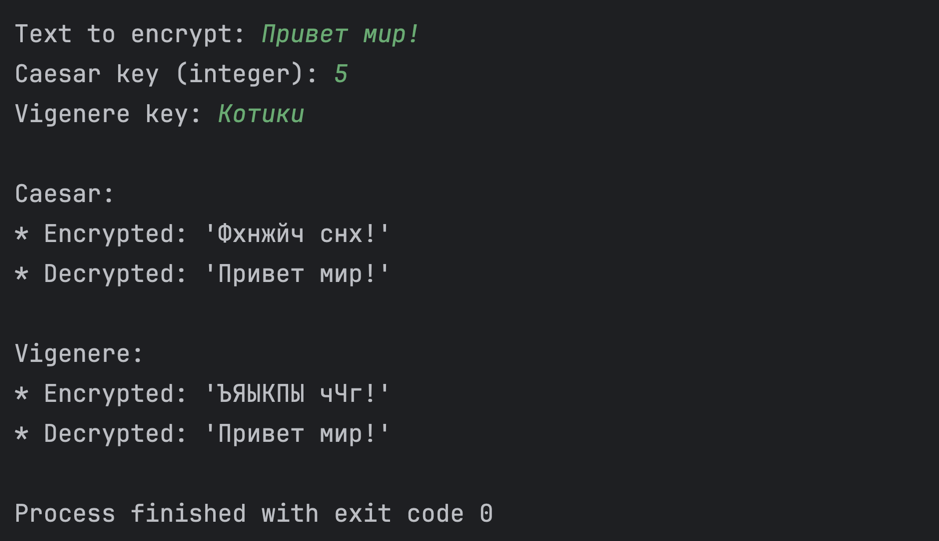
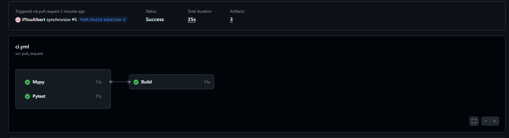
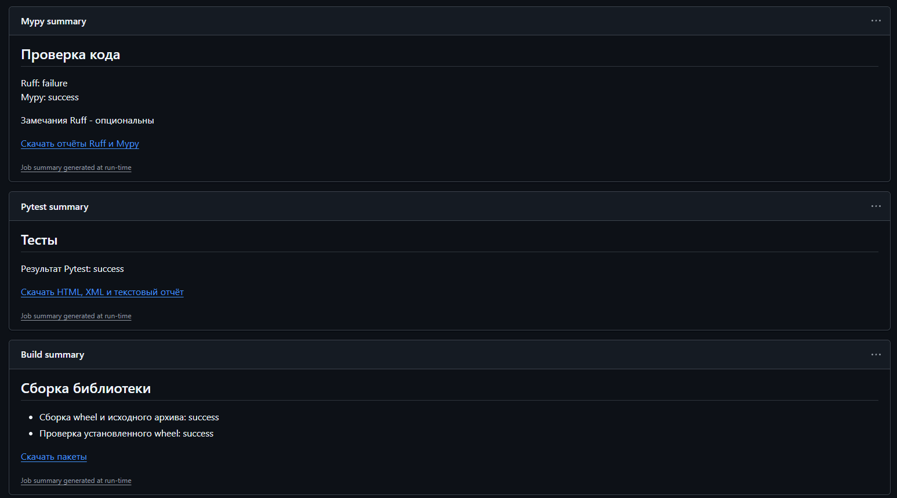
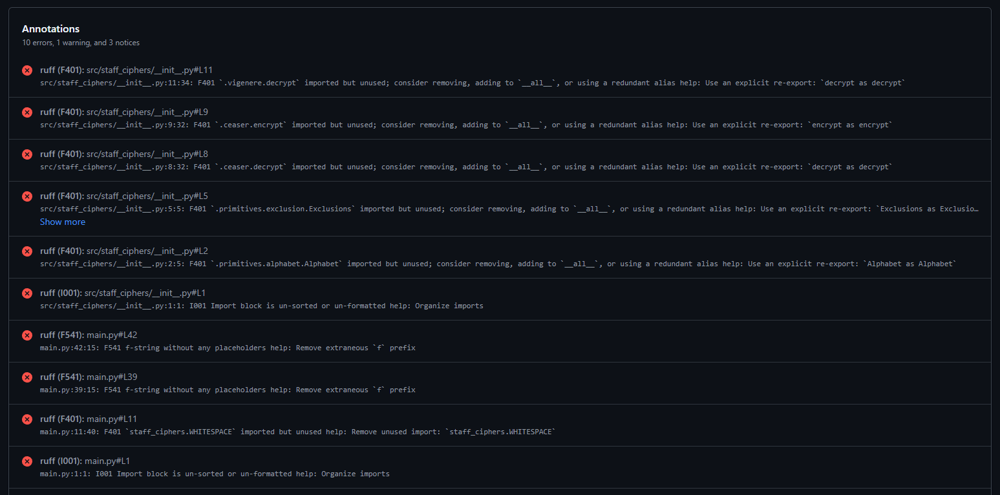

# Цикл практических работ по CI/CD

## Содержание
* [Скриншот работы программы для ПР 6](#скриншот-работы-программы-для-пр-6)
* [Сохраненные логи для ПР 7](#сохраненные-логи-для-пр-7)
* [Скриншоты работы GitHub-workflow для ПР 5](#скриншоты-работы-github-workflow-для-пр-5)
* [Установка и запуск](#установка-и-запуск)
* [Тесты](#тесты)

<br>

## Скриншот работы программы для [ПР 6](https://github.com/ifYouAlbert/staff-ciphers/issues/1)



## Сохраненные логи для [ПР 7](https://github.com/ifYouAlbert/staff-ciphers/issues/3)

* ./static_analysis_out/
  * [README.md](static_analysis_out/README.md)
  * [mypy.txt](static_analysis_out/mypy.txt)
  * [ruff.txt](static_analysis_out/ruff.txt)

## Скриншоты работы GitHub-workflow для [ПР 5](https://github.com/ifYouAlbert/staff-ciphers/issues/2)


<p align="center">Саммари по workflow</p>


<p align="center">Саммари каждого из этапов</p>


<p align="center">Аннотации ruff</p>

<br>

## Установка и запуск

Из корня:

```bash
uv sync
```

Запуск программы:

```bash
uv run main.py
```

## Тесты

Установка:

```bash
uv sync --locked --dev
```

Запуск тестов:

```bash
uv run python -m pytest -v
```

Генерация XML-отчёта:

```bash
uv run python -m pytest --junitxml=test-results/pytest.xml
```

Генерация HTML-отчёта:

```bash
uv run python -m pytest --html=test-results/report.html --self-contained-html
```
